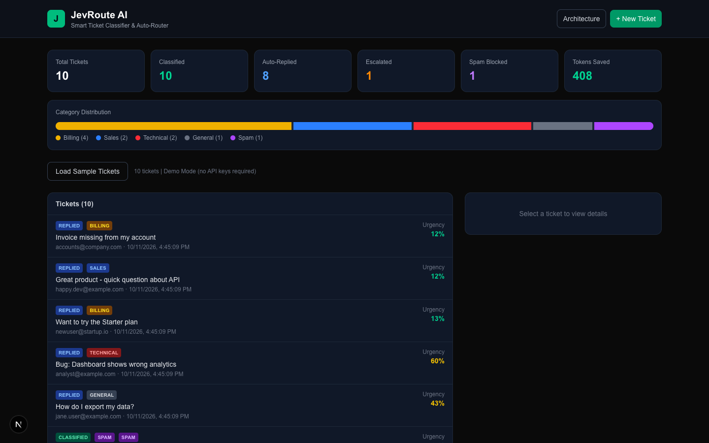
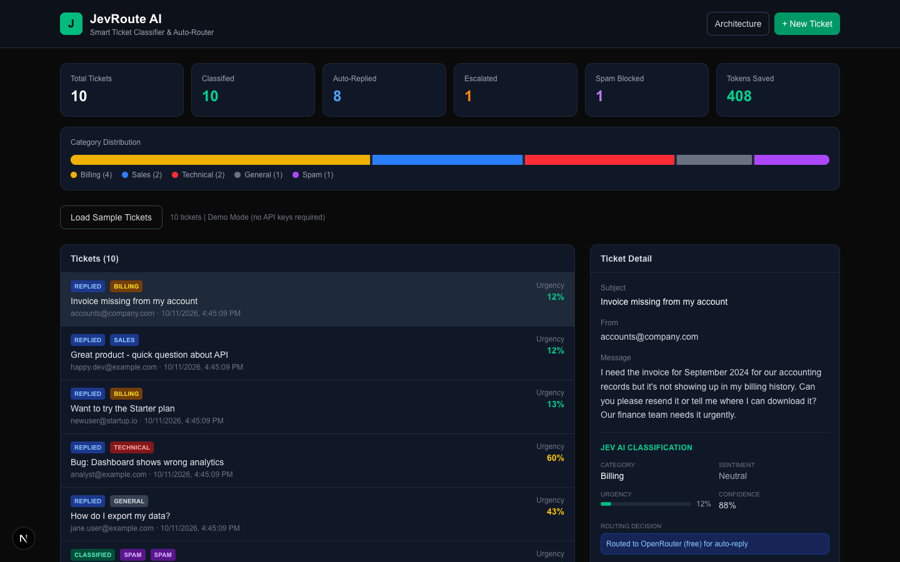
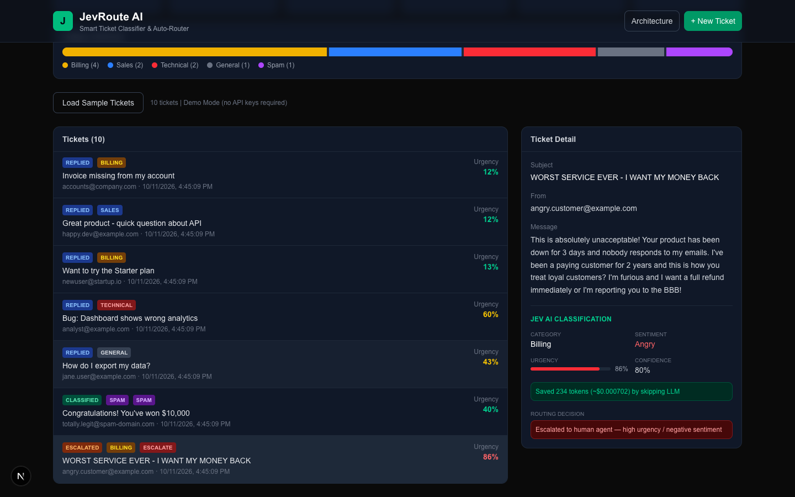
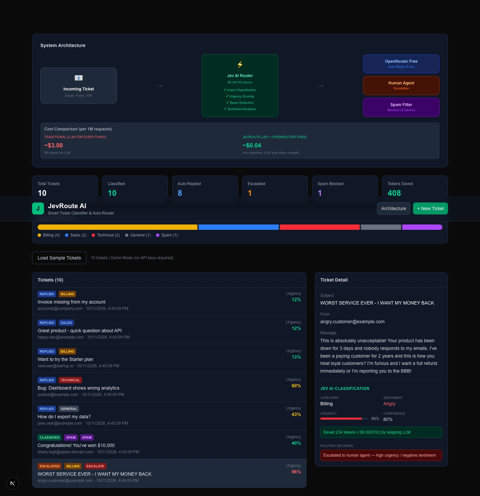
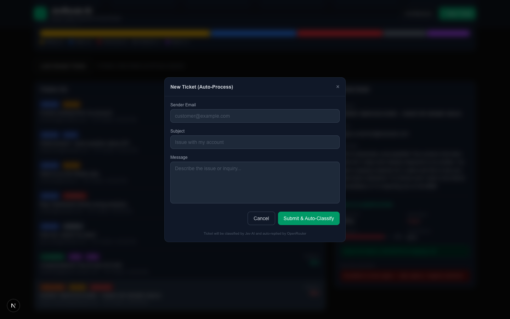
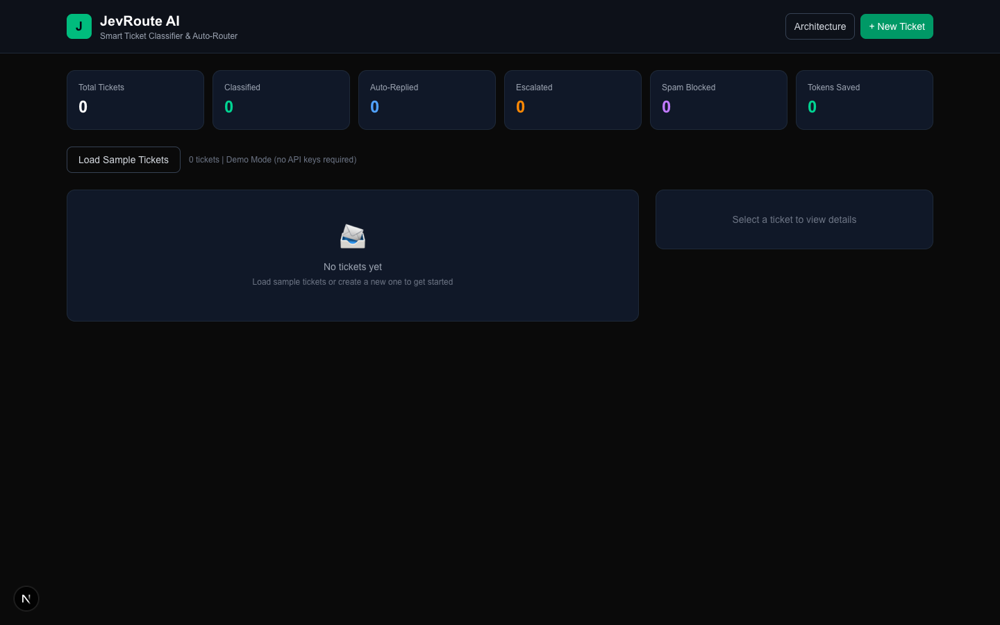

# JevRoute AI — Smart Ticket Classifier & Auto-Router

## Overview

An AI-powered email and support ticket classification system that dramatically reduces LLM costs by using a two-layer AI architecture: **Jev AI** for ultra-cheap intent classification ($0.04/1M tokens) combined with **OpenRouter free models** for auto-reply generation.

**Result: ~98.7% cost reduction** compared to traditional LLM-only approach.

**Live Demo**: Works out of the box without API keys (demo mode included)
**GitHub**: https://github.com/hannesegi/jev-ticket-classifier

---

## Screenshots

### Dashboard — Analytics & Stats

*Real-time analytics showing classification stats, category distribution, and token savings across all processed tickets.*

### Ticket Detail — AI Classification

*Detailed view showing Jev AI classification results: category, sentiment analysis, urgency scoring, confidence level, and auto-generated reply from OpenRouter.*

### Escalation Detection — Angry Customer

*Automatic escalation to human agent when Jev AI detects high urgency (86%) and angry sentiment. No LLM tokens wasted — saves $0.000702 per escalated ticket.*

### System Architecture

*Two-layer architecture: Jev AI Router classifies tickets ($0.04/1M tokens), then routes to OpenRouter (free), Human Agent, or Spam Filter. Cost comparison: ~$3.00 (traditional) vs ~$0.04 (JevRoute).*

### New Ticket — Auto-Process

*Submit a new ticket and it gets automatically classified by Jev AI and replied by OpenRouter in one step.*

### Empty State

*Clean, modern dark-themed dashboard ready for incoming tickets.*

---

## Key Features

| Feature | Description | Powered By |
|---------|-------------|------------|
| Intent Classification | Categorizes tickets: billing, technical, sales, general, spam | Jev AI (Choice) |
| Urgency Scoring | Rates urgency from 0.0 to 1.0 | Jev AI (Score) |
| Spam Detection | Identifies and blocks spam tickets | Jev AI (Boolean) |
| Sentiment Analysis | Detects positive, neutral, negative, angry | Jev AI (Choice) |
| Smart Routing | Routes to auto-reply, human escalation, or spam filter | Jev AI Decision Engine |
| Auto-Reply Generation | Generates contextual customer responses | OpenRouter (Free Models) |
| Cost Analytics | Real-time token savings visualization | Dashboard |
| Demo Mode | Full functionality without API keys | Built-in Simulation |

---

## Technical Architecture

```
Incoming Ticket → Jev AI Router ($0.04/1M tokens)
                      │
              ┌───────┼───────┐
              ▼       ▼       ▼
          Auto-Reply  Human   Spam
          (Free LLM)  Agent   Filter
                      (Alert) (Block)
```

### Cost Comparison

| Approach | Cost per 1M Requests |
|----------|---------------------|
| Traditional (GPT/Claude for everything) | ~$3.00 |
| JevRoute (Jev AI + OpenRouter Free) | ~$0.04 |
| **Savings** | **~98.7%** |

---

## Tech Stack

- **Framework**: Next.js 16 (App Router, TypeScript)
- **Styling**: Tailwind CSS 4
- **Classification**: Jev AI (TypeSafe AI) — $0.042/1M input tokens, free output
- **Text Generation**: OpenRouter (Qwen3-Coder free model)
- **State Management**: In-memory store (demo-ready, can be swapped for database)

---

## API Endpoints

| Method | Endpoint | Description |
|--------|----------|-------------|
| `GET` | `/api/tickets` | List all tickets |
| `POST` | `/api/tickets` | Create ticket with optional auto-processing |
| `POST` | `/api/classify` | Classify ticket via Jev AI |
| `POST` | `/api/generate-reply` | Generate reply via OpenRouter |
| `GET` | `/api/stats` | Get analytics & cost stats |

---

## What I Can Build For You

This project demonstrates my expertise in:

- **AI Cost Optimization** — Reducing LLM costs by 98%+ using smart routing
- **Multi-Model Architectures** — Combining classification and generation models
- **Full-Stack Development** — Next.js, TypeScript, Tailwind CSS
- **API Integration** — Jev AI, OpenRouter, and any LLM provider
- **Production-Ready UI** — Modern dashboard with real-time analytics

I can adapt this architecture for your specific use case:
- Customer support automation
- Email triage and routing
- Content moderation
- Lead scoring and qualification
- Document classification

**Let's talk about how I can help optimize your AI costs.**
